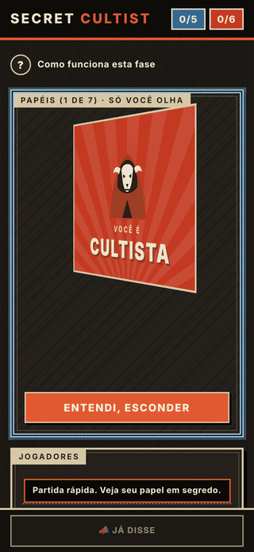
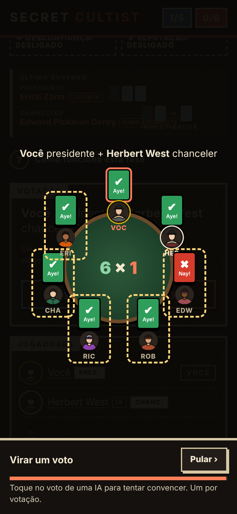
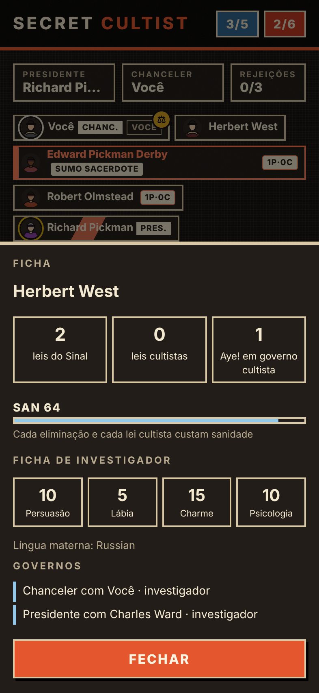
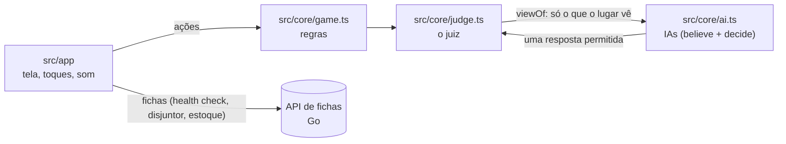

# Secret Cultist

Jogo de dedução social para celular: investigadores contra um culto secreto, liderado em segredo pelo Sumo Sacerdote. Um celular só passa de mão em mão (5 a 10 lugares), ou você joga sozinho contra a IA, em quatro níveis.

**Jogar:** https://secret-game-gamma.vercel.app

<p align="center">
  
  
  
</p>

## O que tem de interessante

- **IA sem modelo de linguagem.** Cada jogador da IA é regra e conta (inferência bayesiana sobre as divisões de papéis possíveis), com personalidade, memória e níveis calibrados para que nenhum lado leve vantagem, medidos por simulação (`scripts/ai_bench.mjs`).
- **Um juiz entre a partida e as IAs.** Nenhuma IA vê mais do que o lugar dela veria: o juiz (`src/core/judge.ts`) monta a visão de cada uma e só aceita as jogadas permitidas.
- **Fichas do Call of Cthulhu, dados d100 e sanidade.** Cada jogador ganha uma ficha de investigador vinda de uma API própria ([cthulhu-char-golang](https://github.com/lucasmagalhaees/cthulhu-char-golang), em Go, num container na Vercel que acorda em milissegundos). Acusar, defender, mentir e virar votos rolam d100 contra as perícias da ficha, com animação. Cada eliminação e cada lei do culto custam sanidade (SAN); abalado, o jogador rola mais baixo.
- **Resiliência.** A API é um adicional: um health check, um circuit breaker que para de chamá-la quando ela cai e religa sozinho, e um estoque de fichas guardado no celular, renovado aos poucos, para jogar mesmo com ela fora do ar.
- **Debate e social.** Acusações com provas tiradas da ata (em combo), réplica e tréplica, veredito da mesa, pedidos às IAs, ficha de cada jogador.
- **PWA.** Abre sem internet depois da primeira vez e avisa quando sai versão nova.

## Arquitetura



TypeScript estrito, sem framework, empacotado num único `index.html` pelo Vite. O núcleo (`src/core/`) é lógica pura, sem DOM, rede nem armazenamento, testado no Node e no navegador; a página (`src/app/`) só desenha e reage. Detalhes, requisitos e decisões em [`CLAUDE.md`](CLAUDE.md) e [`docs/decisoes.md`](docs/decisoes.md).

## Estrutura

```
index.html
src/main.ts
src/core/
src/core/dlc.ts
src/app/
src/sw.js
src/styles.css
vite.config.js
tsconfig.json
vercel.json
scripts/verify.sh
scripts/check_production.py
scripts/rename.py
scripts/ai_bench.mjs
scripts/dlc.mjs
scripts/readme_shots.py
tests/unit.cases.mjs
tests/core.mjs
tests/unit.py
tests/contract.py
tests/docs_check.py
tests/e2e.py
tests/pwa.py
tests/cov.py
tests/fixtures/source/
.github/workflows/ci.yml
.github/workflows/producao.yml
.claude/settings.json
docs/decisoes.md
docs/verificacao.md
```

## Qualidade

`scripts/verify.sh` roda tudo antes de cada PR: tipos, build, checagem da documentação contra o código, casos do núcleo, contrato da API com respostas reais gravadas, testes ponta a ponta com Playwright (partidas inteiras pela tela), PWA offline e cobertura medida no navegador (mínimo de 95% das funções). Cada merge na `main` publica na Vercel, e um workflow confere que a produção está servindo o commit certo.

Para rodar: `npm install` e `npm run dev`. Para testar tudo: `scripts/verify.sh`.

## Créditos

Adaptação de [Secret Hitler](https://www.secrethitler.com), de Goat, Wolf, & Cabbage, licenciado em [CC BY-NC-SA 4.0](https://creativecommons.org/licenses/by-nc-sa/4.0/). Este app herda a licença: uso não comercial, com crédito, e adaptações sob a mesma licença.
